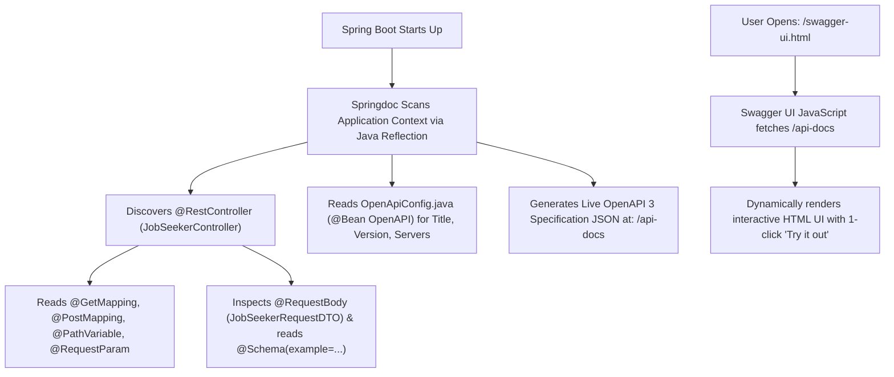

# Step 2B: Job Seeker Microservice (`jobseeker-service`) — Architectural & API Proposal Guide

> **Module Name:** `jobseeker-service`  
> **Assigned Port:** `8083`  
> **Database:** Local MySQL Database (`jobseeker_db`, table `job_seekers`)  
> **Registry Integration:** Registers automatically with `eureka-server` (Port `8761`)  
> **Status:** Gate 1 Proposal & Architectural Alignment Phase (No code generated yet)

---

## 1. Feature Overview & Role in the Ecosystem

In the Job Search System (JSS), the **Job Seeker Microservice** manages the candidate side of the recruitment platform:
1. **The Second Independent Actor:** Like `employer-service`, `jobseeker-service` has **zero external dependencies** — candidate profiles can be created, updated, and searched independently.
2. **Prerequisite for Applications (Step 4):** A candidate cannot apply for a job without a registered `jobSeekerId`.
3. **Core Recruiter Discovery Tool:** Employers and HR recruiters use this service to search for suitable candidates based on technical skills (e.g. `"Java"`, `"Spring Boot"`), location, and years of experience.
4. **Second Eureka Client:** Registers dynamically with Eureka Discovery Server on port `8761` alongside `employer-service`.

---

## 2. File & Folder Inventory: What Will Be Created

Per our project directives in `antigravity.md`:
* **Project Lombok:** Strictly used across all Entities and DTOs (`@Data`, `@NoArgsConstructor`, `@AllArgsConstructor`, `@Builder`).
* **Database:** Strict local MySQL database (`jobseeker_db`). No H2 and no PostgreSQL.
* **Testing:** No `src/test` folders during build.

```
jss-capstone/
├── pom.xml                                           <-- Register <module>jobseeker-service</module>
└── jobseeker-service/                                <-- NEW SUB-MODULE FOLDER
    ├── pom.xml                                       <-- Child POM (Web, JPA, Validation, MySQL Driver, Eureka Client, Lombok, Swagger)
    └── src/
        └── main/
            ├── java/com/jss/jobseeker/
            │   ├── JobSeekerServiceApplication.java   <-- Spring Boot entry point on Port 8083
            │   ├── config/
            │   │   ├── OpenApiConfig.java            <-- Swagger UI metadata for Port 8083
            │   │   └── DataInitializer.java          <-- Seed realistic candidate profiles into MySQL
            │   ├── controller/
            │   │   └── JobSeekerController.java       <-- Finalized REST endpoints
            │   ├── dto/
            │   │   ├── JobSeekerRequestDTO.java       <-- Input payload (Lombok + Bean Validation + @Schema)
            │   │   └── JobSeekerResponseDTO.java      <-- Output payload (Lombok + @Schema)
            │   ├── entity/
            │   │   └── JobSeeker.java                 <-- JPA Entity (15 fields, Lombok + @Entity + @Table)
            │   ├── exception/
            │   │   ├── ErrorResponse.java            <-- Standard RFC JSON error schema
            │   │   ├── GlobalExceptionHandler.java   <-- @RestControllerAdvice clean error mapping
            │   │   ├── JobSeekerNotFoundException.java <-- 404 Not Found
            │   │   ├── DuplicateJobSeekerException.java <-- 409 Conflict
            │   │   └── CannotDeleteJobSeekerWithActiveApplicationsException.java <-- Architectural Template (unwired until Step 4)
            │   ├── repository/
            │   │   └── JobSeekerRepository.java       <-- Spring Data JPA derived queries
            │   └── service/
            │       ├── JobSeekerService.java          <-- Interface
            │       └── impl/JobSeekerServiceImpl.java <-- Business logic, @Transactional & mappings
            └── resources/
                └── application.properties            <-- Port 8083, Eureka URL, Local MySQL (jobseeker_db)
```

---

## 3. Step A: Interactive API Proposal & Review

Here is the complete candidate API menu for `jobseeker-service` based on `Job Search System.docx`. Please review so we can finalize which endpoints to keep:

### Tier 1: Core / Mandatory APIs (Base Candidate Profile Management)

| Method | Endpoint URI | Request Body | Response Body | Status Code | Real-World Scenario |
| :--- | :--- | :--- | :--- | :--- | :--- |
| **`POST`** | `/api/jobseekers` | `JobSeekerRequestDTO` | `JobSeekerResponseDTO` | `201 Created` | **Candidate Onboarding:** A new candidate registers their professional profile (name, email, phone, skills, experience, CTC, notice period). |
| **`GET`** | `/api/jobseekers/{id}` | *None* | `JobSeekerResponseDTO` | `200 OK` | **Profile View:** The candidate views their own profile, or an employer clicks on an applicant's card to inspect their qualifications. |
| **`PUT`** | `/api/jobseekers/{id}` | `JobSeekerRequestDTO` | `JobSeekerResponseDTO` | `200 OK` | **Resume / Profile Update:** The candidate updates their skills (e.g. learned Docker), current designation, expected CTC, or notice period. |
| **`DELETE`** | `/api/jobseekers/{id}` | *None* | `Map<String, String>` | `200 OK` | **Account Deletion:** Candidate chooses to close their profile on the platform. |

---

### Tier 2: Candidate Listing & Unified Search/Filter (User Aligned)

* **API 3: Simple Candidate Directory Listing:** `GET /api/jobseekers`  
  * Returns all candidates registered on the platform without complex filtering. Clean and fast.
* **API 4: Unified Candidate Search & Filter Endpoint:** `GET /api/jobseekers/search?skill=...&city=...&minExperience=...`  
  * Provides a single, powerful search and filter interface for recruiters and employers:
    * **Search Candidates by Skills:** `?skill=Java` (matches `"Java, Spring Boot, MySQL"`)
    * **Search Candidates by Location:** `?city=Bengaluru`
    * **Search Candidates by Experience:** `?minExperience=3.0` (returns candidates with $\ge 3$ years experience)
    * **Combined Search:** `?skill=Java&city=Bengaluru&minExperience=3.0` (all 3 criteria together)
  * Powers both the search bar (e.g. typing a skill) and the filter dropdowns (selecting city and experience range) in one single, versatile API!

---

## 4. Step B: Interactive Exception Handling & Error Scenario Review

Here are the potential exceptions for `jobseeker-service`:

### Exception 1: `JobSeekerNotFoundException` (HTTP 404 Not Found)
* **What triggers it:** Looking up, updating, or deleting a candidate ID that does not exist in `jobseeker_db`.
* **Scenario:** A recruiter clicks on an old bookmarked candidate link whose account was deleted.
* **Recommendation:** **MANDATORY (KEEP)**.

### Exception 2: `DuplicateJobSeekerException` (HTTP 409 Conflict)
* **What triggers it:** Attempting to register or update with an email address already owned by another registered candidate.
* **Scenario:** A candidate forgets they already registered and tries to sign up again with the same personal email.
* **Recommendation:** **MANDATORY (KEEP)**.

### Exception 3: `MethodArgumentNotValidException` (HTTP 400 Bad Request)
* **What triggers it:** Bean Validation failure (blank first name, negative experience, negative expected CTC, invalid 10-digit phone).
* **Scenario:** Candidate enters `-2.5` for years of experience or leaves the email field blank.
* **Recommendation:** **MANDATORY (KEEP)**.

### Exception 4: `CannotDeleteJobSeekerWithActiveApplicationsException` (HTTP 409 Conflict - Template)
* **What triggers it:** Trying to delete a candidate profile who currently has active job applications in progress.
* **Architectural Strategy:** Following the same pattern as Step 2A, we create this exception as an **architectural template class (unwired)**. In Step 4 (`application-service`), when OpenFeign clients are added, this exception will be wired into the delete flow!

---

## 5. Technical Highlights & Code Comparison

### A. The 15 Entity Fields (`JobSeeker.java`)
Directly mapped from `Job Search System.docx`:
1. `jobSeekerId` (`Long`, Primary Key)
2. `firstName` (`String`, Mandatory)
3. `lastName` (`String`, Mandatory)
4. `email` (`String`, Unique, Mandatory)
5. `contactNumber` (`String`, 10-digit, Mandatory)
6. `address` (`String`)
7. `city` (`String`, Mandatory)
8. `state` (`String`)
9. `totalExperience` (`Double`, Mandatory, e.g. `3.5` years)
10. `currentDesignation` (`String`, e.g. `"Software Engineer"`)
11. `expectedCTC` (`Double`, Mandatory, e.g. `1200000.0`)
12. `noticePeriod` (`Integer`, Notice period in days, e.g. `30` or `0` for Immediate Joiner)
13. `skills` (`String`, Mandatory, e.g. `"Java, Spring Boot, MySQL, REST APIs"`)
14. `qualification` (`String`, e.g. `"B.Tech in Computer Science"`)
15. `createdDate` (`LocalDateTime`, Auto-populated with `@PrePersist`)

### B. Clean Lombok Boilerplate
```java
@Entity
@Table(name = "job_seekers")
@Data
@NoArgsConstructor
@AllArgsConstructor
@Builder
public class JobSeeker {
    @Id
    @GeneratedValue(strategy = GenerationType.IDENTITY)
    private Long jobSeekerId;
    // ... all 15 fields
}
```

### C. Numeric Validation Annotations (`JobSeekerRequestDTO.java`)
```java
@NotNull(message = "Total experience cannot be null")
@PositiveOrZero(message = "Total experience cannot be negative")
private Double totalExperience;

@NotNull(message = "Expected CTC cannot be null")
@Positive(message = "Expected CTC must be greater than zero")
private Double expectedCTC;

@NotNull(message = "Notice period cannot be null")
@PositiveOrZero(message = "Notice period in days cannot be negative")
private Integer noticePeriod;
```

### D. Local MySQL Configuration (`application.properties`)
```properties
server.port=8083
spring.application.name=jobseeker-service

spring.datasource.url=jdbc:mysql://localhost:3306/jobseeker_db?createDatabaseIfNotExist=true&useSSL=false&serverTimezone=UTC&allowPublicKeyRetrieval=true
spring.datasource.username=root
spring.datasource.password=root

eureka.client.service-url.defaultZone=http://localhost:8761/eureka/
eureka.instance.prefer-ip-address=true
eureka.instance.instance-id=${spring.application.name}:${server.port}:${random.value}
```

---

## 6. Verification Strategy

1. Start `eureka-server` (Port `8761`).
2. Start `employer-service` (Port `8082`).
3. Start `jobseeker-service` (Port `8083`).
4. **Eureka Dashboard Verification (`http://localhost:8761`):**  
   Both **`EMPLOYER-SERVICE`** and **`JOBSEEKER-SERVICE`** will show as active registered instances!
5. **Swagger UI Verification:**  
   Open `http://localhost:8083/swagger-ui.html` $\rightarrow$ Test candidate creation, search by skill, and profile updates.
6. **MySQL Workbench Verification:**  
   Refresh schemas $\rightarrow$ Check table `jobseeker_db.job_seekers` to inspect the auto-seeded candidate profiles.

---

## 7. Doubt Solving & Conceptual Deep-Dives

### Doubt 1: Can search and filtering be combined into the `/search` API? How do search bars and filter dropdowns use it?

#### The Architectural Solution:
Yes! This is the cleanest and most practical REST design pattern for recruitment platforms:
1. **`GET /api/jobseekers` (The Plain Directory):**
   * Acts as a basic listing endpoint. When an admin or recruiter opens the "Candidates" tab with no search filters applied, this returns the registered candidates.
2. **`GET /api/jobseekers/search?skill=...&city=...&minExperience=...` (The Unified Search Engine):**
   * Instead of creating 3 separate endpoints (`/searchBySkill`, `/searchByCity`, `/searchByExp`), this single search endpoint handles every scenario flexibly:
     * **Scenario A (Search Bar Only):** Recruiter types `"React"` into the search bar $\rightarrow$ Frontend calls `GET /api/jobseekers/search?skill=React`.
     * **Scenario B (Location Dropdown Only):** Recruiter selects `"Mumbai"` in the city dropdown $\rightarrow$ Frontend calls `GET /api/jobseekers/search?city=Mumbai`.
     * **Scenario C (Experience Slider Only):** Recruiter filters for at least 5 years experience $\rightarrow$ Frontend calls `GET /api/jobseekers/search?minExperience=5.0`.
     * **Scenario D (Combined Search & Filter):** Recruiter searches `"Java"`, selects `"Bengaluru"`, and slides experience to `3.0` $\rightarrow$ Frontend calls:
       ```
       GET /api/jobseekers/search?skill=Java&city=Bengaluru&minExperience=3.0
       ```
   * **Result:** The backend dynamically applies only the parameters that are provided and ignores the ones that are null/blank!

---

### Doubt 2: Deep Dive into `DataInitializer.java` and Swagger/`OpenApiConfig.java` Mechanics

#### Part A: `DataInitializer.java` (Database Seeding)
1. **Is this a temporary insert that deletes when the microservice shuts down?**
   * **NO, IT IS PERMANENT!**
   * In the practice prototype (`jss-practice`), we used an H2 in-memory database that was wiped on shutdown.
   * But in this actual capstone project, we are connected to **Local MySQL** (`jobseeker_db`). MySQL persists data to physical disk. When `DataInitializer` runs, the 3 candidate records are permanently written to your hard drive. If you shut down Spring Boot, restart your computer, and open MySQL Workbench, those 3 records will still be there!
2. **What if the database already has 4–5 records? Does it re-insert or create duplicates?**
   * Look at the guard check inside `DataInitializer.java`:
     ```java
     if (jobSeekerRepository.count() == 0) {
         // ONLY runs when the table is 100% EMPTY!
         jobSeekerRepository.saveAll(List.of(candidate1, candidate2, candidate3));
     }
     ```
   * If your MySQL database already contains even 1 record (`count() > 0`), the `if` check evaluates to `false` and **does absolutely nothing**. It will never duplicate or overwrite your existing data!
3. **Do real production systems need `DataInitializer`?**
   * In enterprise production where real users sign up via frontend apps, you don't seed dummy data (or you restrict it to `@Profile("dev")`).
   * **Why it is invaluable for our capstone:** When an evaluator, interviewer, or professor runs your project for the first time, they don't have to spend 15 minutes manually typing JSON in Postman to create candidates, employers, and jobs before they can test searching and applying. The entire system is immediately testable out-of-the-box!

---

#### Part B: How `OpenApiConfig.java` and Swagger UI Work Behind the Scenes
When you add `springdoc-openapi-starter-webmvc-ui` to `pom.xml`, Springdoc activates an automated documentation engine:



1. **How does Swagger know the list of APIs we created?**
   * Using **Java Reflection**, Springdoc inspects the compiled `.class` files in memory.
   * It scans for `@RestController`, `@RequestMapping("/api/jobseekers")`, `@GetMapping`, and `@PostMapping`.
   * For every method, it extracts the HTTP method, the path, query parameters (`@RequestParam`), and status codes (`@ApiResponses`).
2. **How does it know `@Schema` and pre-fill the request body?**
   * When Springdoc sees `@RequestBody JobSeekerRequestDTO`, reflection inspects every field in `JobSeekerRequestDTO.java`.
   * When it finds:
     ```java
     @Schema(description = "10-digit mobile phone number", example = "9876543210")
     private String contactNumber;
     ```
   * Springdoc extracts `"9876543210"` and uses it as the default value in the Swagger UI request body textarea.
3. **What does `OpenApiConfig.java` do? Why do we need it?**
   * Without `OpenApiConfig.java`, Swagger UI works, but displays ugly generic titles: *"OpenAPI definition - v0"*.
   * `OpenApiConfig.java` customizes the top banner and server dropdown:
     * Custom Title: *"Job Search System — Job Seeker Microservice API"*
     * Developer Contact: Sathish Nadar
     * Servers: Adds `http://localhost:8083` (Direct) and `http://localhost:8080/api/jobseekers` (API Gateway).

---

## 8. Final Agreed Blueprint for Step 2B

### Finalized API Menu (6 Endpoints):
1. `POST /api/jobseekers` — Register new candidate profile (`201 Created`).
2. `GET /api/jobseekers/{id}` — Lookup candidate profile by ID (`200 OK`).
3. `GET /api/jobseekers` — Get all candidates (simple directory listing) (`200 OK`).
4. `GET /api/jobseekers/search` — Unified search & filter candidates by `skill`, `city`, and/or `minExperience` (`200 OK`).
5. `PUT /api/jobseekers/{id}` — Update candidate profile with smart email conflict check (`200 OK`).
6. `DELETE /api/jobseekers/{id}` — Delete candidate profile (`200 OK`).

### Finalized Exception Strategy:
1. `JobSeekerNotFoundException` (HTTP 404 Not Found) — Candidate ID does not exist.
2. `DuplicateJobSeekerException` (HTTP 409 Conflict) — Email already registered.
3. `MethodArgumentNotValidException` (HTTP 400 Bad Request) — Bean Validation failures.
4. `CannotDeleteJobSeekerWithActiveApplicationsException` (HTTP 409 Conflict) — Architectural template class (unwired until Step 4).

---

## 9. Gate 2: Implementation Permission Status
* **API Blueprint Approved:** 6 Endpoints with Unified Search.
* **Exception Strategy Approved:** 4 Exceptions (404, 409, 400, and unwired template).
* **Ready for Code Generation:** Awaiting user's explicit "proceed" / implementation command.
