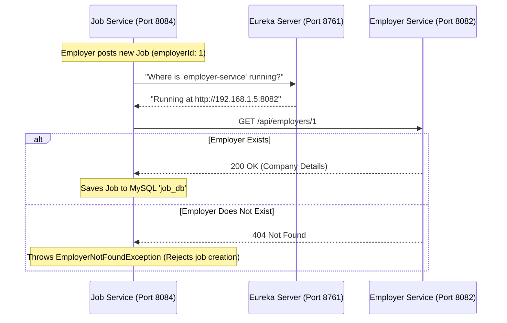
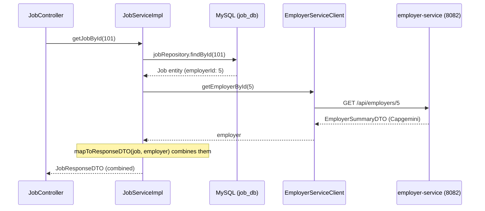

# Step 3: Job Microservice (`job-service`) — Architectural, OpenFeign & API Proposal Guide

> **Module Name:** `job-service`  
> **Assigned Port:** `8084`  
> **Database:** Local MySQL Database (`job_db`, table `jobs`)  
> **Registry Integration:** Registers with `eureka-server` (Port `8761`)  
> **First Inter-Service Link:** **Spring Cloud OpenFeign** client calling `employer-service` (Port `8082`)  
> **Status:** Gate 1 Proposal & Architectural Alignment Phase (No code generated yet)

---

## 1. Feature Overview & Role in the Ecosystem

In the Job Search System (JSS), the **Job Microservice** is the recruitment engine where hiring opportunities live:
1. **The Bridge Between Actors:** Step 2 created the two independent actors (`employer-service` and `jobseeker-service`). Step 3 creates the **Job Postings** that candidates discover and apply for.
2. **The First Real Distributed Interaction:** A job posting **cannot exist without a valid employer**. When creating a job, `job-service` does NOT duplicate employer tables. Instead, it makes an automated inter-service HTTP call to `employer-service` via **OpenFeign** to verify the employer's existence.
3. **Candidate Discovery Engine:** Candidates use this service to search and filter jobs by skills (e.g. `"Java, Spring Boot"`), job location, experience requirements, and employment type.
4. **Third Eureka Client:** Registers dynamically with Eureka Discovery Server on port `8761`.

---

## 2. File & Folder Inventory: What Will Be Created

Per our project directives in `antigravity.md`:
* **Project Lombok:** Strictly used across Entity and DTOs (`@Data`, `@NoArgsConstructor`, `@AllArgsConstructor`, `@Builder`).
* **Database:** Strict local MySQL database (`job_db`). No H2 and no PostgreSQL.
* **Testing:** No `src/test` folders during build.
* **OpenFeign:** Client interface located in `client/` package.

```
jss-capstone/
├── pom.xml                                           <-- Register <module>job-service</module>
└── job-service/                                      <-- NEW SUB-MODULE FOLDER
    ├── pom.xml                                       <-- Child POM (Web, JPA, Validation, MySQL Driver, Eureka Client, OpenFeign, Lombok, Swagger)
    └── src/
        └── main/
            ├── java/com/jss/job/
            │   ├── JobServiceApplication.java         <-- Spring Boot entry point with @EnableFeignClients on Port 8084
            │   ├── client/
            │   │   └── EmployerServiceClient.java     <-- Declarative OpenFeign client calling employer-service
            │   ├── config/
            │   │   ├── OpenApiConfig.java            <-- Swagger UI metadata for Port 8084
            │   │   └── DataInitializer.java          <-- Seed realistic job postings into MySQL
            │   ├── controller/
            │   │   └── JobController.java             <-- Finalized REST endpoints
            │   ├── dto/
            │   │   ├── EmployerSummaryDTO.java        <-- External DTO received from employer-service
            │   │   ├── JobRequestDTO.java             <-- Input payload (Lombok + Bean Validation + @Schema)
            │   │   └── JobResponseDTO.java            <-- Output payload with embedded company details (Lombok + @Schema)
            │   ├── entity/
            │   │   └── Job.java                       <-- JPA Entity (16 fields, Lombok + @Entity + @Table)
            │   ├── exception/
            │   │   ├── ErrorResponse.java            <-- Standard RFC JSON error schema
            │   │   ├── GlobalExceptionHandler.java   <-- @RestControllerAdvice clean error mapping
            │   │   ├── JobNotFoundException.java      <-- 404 Not Found
            │   │   ├── EmployerNotFoundException.java <-- 404 (when Feign fails to find employer)
            │   │   ├── InvalidSalaryRangeException.java <-- 400 Bad Request (when salaryMin > salaryMax)
            │   │   └── CannotDeleteJobWithActiveApplicationsException.java <-- Architectural Template (unwired until Step 4)
            │   ├── repository/
            │   │   └── JobRepository.java             <-- Spring Data JPA derived queries + dynamic JPQL search
            │   └── service/
            │       ├── JobService.java                <-- Interface
            │       └── impl/JobServiceImpl.java       <-- Business logic, OpenFeign verification & @Transactional
            └── resources/
                └── application.properties            <-- Port 8084, Eureka URL, Local MySQL (job_db)
```

---

## 3. Core Technical Concept: Spring Cloud OpenFeign

### What is OpenFeign?
In a monolithic application, when you want data from another module, you simply call a Java method: `employerService.getEmployerById(id)`.

In microservices, `employer-service` is a completely separate process running on a different port. Traditionally, developers had to write 30 lines of verbose `RestTemplate` or `HttpClient` code, managing JSON parsing, connection timeouts, and hardcoded URLs.

**Spring Cloud OpenFeign solves this elegantly:**  
You write **just a Java interface with Spring MVC annotations**, and Spring automatically generates the underlying HTTP client at runtime!

```java
@FeignClient(name = "employer-service")
public interface EmployerServiceClient {

    @GetMapping("/api/employers/{id}")
    EmployerSummaryDTO getEmployerById(@PathVariable("id") Long id);
}
```

### How Does OpenFeign Connect With Eureka?


* **No Hardcoded URLs:** Notice that `@FeignClient(name = "employer-service")` uses the service name registered in Eureka!
* If `employer-service` changes ports or runs on multiple servers, Eureka handles the lookup and load balancing automatically.

---

## 4. Step A: Interactive API Proposal & Review

Here is the candidate API menu for `job-service`. Please review so we can align on which endpoints to keep:

### Tier 1: Core / Mandatory APIs (Base Job Lifecycle)

| Method | Endpoint URI | Request Body | Response Body | Status Code | Real-World Scenario |
| :--- | :--- | :--- | :--- | :--- | :--- |
| **`POST`** | `/api/jobs` | `JobRequestDTO` | `JobResponseDTO` | `201 Created` | **Job Publishing:** An employer posts an opening for a "Senior Java Developer". Verifies `employerId` via OpenFeign with `employer-service`. |
| **`GET`** | `/api/jobs/{id}` | *None* | `JobResponseDTO` | `200 OK` | **Job Details Page:** A candidate clicks on a job card to read the full description, qualifications, and salary range. |
| **`PUT`** | `/api/jobs/{id}` | `JobRequestDTO` | `JobResponseDTO` | `200 OK` | **Job Editing:** The employer modifies the job description, updates salary limits, or changes status to `CLOSED`. |
| **`DELETE`** | `/api/jobs/{id}` | *None* | `Map<String, String>` | `200 OK` | **Job Removal:** Employer unpublishes or deletes an expired job opening. |

---

### Tier 2: Search, Filter & Recruiter Listings (User Aligned)

* **API 5: Simple Job Directory Listing:** `GET /api/jobs`  
  * Returns all jobs currently accepting applications (`status = 'ACTIVE'`).
* **API 6: Unified 5-Factor Candidate Job Search & Filter:**  
  `GET /api/jobs/search?skill=...&jobTitle=...&designation=...&location=...&employerId=...`  
  * **Powers both search bar and candidate filter controls across 5 key recruitment factors:**
    1. **Search by Skill:** `?skill=React` (matches `"JavaScript, React.js, Redux"`)
    2. **Search by Job Title:** `?jobTitle=Developer` (matches `"Senior Java Developer"`)
    3. **Search by Designation:** `?designation=Software Engineer`
    4. **Search by Location:** `?location=Bengaluru` (or `"Remote"`)
    5. **Search by Company / Employer:** `?employerId=1` (lists all jobs published by Capgemini)
    * **Combined Multi-Filter:** `?skill=Java&jobTitle=Developer&location=Bengaluru&employerId=1`
* **API 7: Get Jobs By Employer (Employer Portal):** `GET /api/jobs/employer/{employerId}`  
  * Returns all jobs published by a specific company (both `ACTIVE` and `INACTIVE` so employers can manage and reopen vacancies).

---

## 5. Step B: Interactive Exception Handling & Error Scenario Review

Here is the finalized exception strategy for `job-service`:

### Exception 1: `JobNotFoundException` (HTTP 404 Not Found)
* **What triggers it:** Querying, updating, or toggling status for a `jobId` that does not exist in `job_db`.
* **Scenario:** A candidate attempts to view a job ID that does not exist.
* **Recommendation:** **MANDATORY (KEEP)**.

### Exception 2: `EmployerNotFoundException` (HTTP 404 Not Found)
* **What triggers it:** Attempting to post a job with an `employerId` that does not exist in `employer-service`.
* **Scenario:** A client submits `POST /api/jobs` with `"employerId": 999`. OpenFeign queries `employer-service`, receives 404, and `job-service` rejects the job posting.
* **Recommendation:** **MANDATORY (KEEP)**.

### Exception 3: `DuplicateJobException` (HTTP 409 Conflict)
* **What triggers it:** An employer attempts to publish a job with a `jobTitle` that they already have open and `ACTIVE` on the platform.
* **Scenario:** HR at Capgemini accidentally clicks "Post Job" twice for `"React Developer"`, preventing duplicate active job postings.
* **Recommendation:** **MANDATORY (KEEP)**.

### Exception 4: `MethodArgumentNotValidException` (HTTP 400 Bad Request)
* **What triggers it:** Standard Bean Validation failure (blank title, negative experience, negative salary, invalid contact email).
* **Recommendation:** **MANDATORY (KEEP)**.

*(Note: `InvalidSalaryRangeException` was DISCARDED as it belongs to frontend form validation. `CannotDeleteJobWithActiveApplicationsException` was DISCARDED because jobs use soft-closing / status toggles (`ACTIVE` $\leftrightarrow$ `INACTIVE`) rather than dangerous hard-deletion).*

---

## 6. The 16 Entity Fields (`Job.java`)

Directly derived from `Job Search System.docx`:
1. `jobId` (`Long`, Primary Key)
2. `employerId` (`Long`, Mandatory — referenced via OpenFeign)
3. `jobTitle` (`String`, Mandatory, e.g. `"Senior Java Developer"`)
4. `designation` (`String`, e.g. `"Lead Software Engineer"`)
5. `description` (`String`, Mandatory, length = 2000)
6. `requiredSkills` (`String`, Mandatory, length = 1000)
7. `experienceRequired` (`Double`, Mandatory, $\ge 0$)
8. `qualification` (`String`, e.g. `"B.Tech / B.E. / MCA"`)
9. `salaryMin` (`Double`, Mandatory, $> 0$)
10. `salaryMax` (`Double`, Mandatory, $> 0$)
11. `location` (`String`, Mandatory, e.g. `"Bengaluru"` or `"Remote"`)
12. `noticePeriod` (`Integer`, days, $\ge 0$)
13. `contactEmail` (`String`, Mandatory, valid email)
14. `employmentType` (`String`, Mandatory, e.g. `"FULL_TIME"`, `"PART_TIME"`, `"CONTRACT"`)
15. `status` (`String`, Mandatory, default `"ACTIVE"`, e.g. `"ACTIVE"`, `"CLOSED"`, `"DRAFT"`)
16. `createdDate` (`LocalDateTime`, Auto-populated with `@PrePersist`)

---

## 7. Verification Strategy

1. Start `eureka-server` (Port `8761`).
2. Start `employer-service` (Port `8082`).
3. Start `job-service` (Port `8084`).
4. **Eureka Verification:** Confirm **`JOB-SERVICE`** registers on Eureka dashboard alongside `EMPLOYER-SERVICE` and `JOBSEEKER-SERVICE`.
5. **OpenFeign Cross-Service Test (Positive):**  
   Post a job with `"employerId": 1` (Capgemini exists) $\rightarrow$ Returns `201 Created` with company details embedded!
6. **OpenFeign Cross-Service Test (Negative):**  
   Post a job with `"employerId": 999` $\rightarrow$ Fails with `404 Not Found: Employer not found with ID: 999`!
7. **MySQL Workbench Verification:** Check table `job_db.jobs` to inspect the persisted job records.

---

## 8. Doubt Solving & Conceptual Deep-Dives

### Doubt 1: Why use soft status toggling (`ACTIVE` vs `INACTIVE`) instead of hard deletion and `CannotDeleteJobWithActiveApplicationsException`?

#### The Real-World Engineering Insight:
1. **The Danger of Hard Deletion (`DELETE FROM jobs WHERE id = ?`):**
   * If an employer deletes a job while 50 candidates are interviewing, all application records become corrupted orphans!
   * Candidate application history crashes because `jobId` points to nothing.
2. **The Soft Status Solution:**
   * Instead of physically deleting jobs from MySQL, the table maintains a `status` column:
     * `status = "ACTIVE"`: Job is live and visible to candidates in searches.
     * `status = "INACTIVE"`: Job is closed or paused. It is hidden from candidate search results, but candidates who already applied can still see their application history, status, and company remarks!
   * The employer can easily toggle this via `PUT /api/jobs/{id}` or `PATCH /api/jobs/{id}/status?status=INACTIVE`.
   * **Result:** Eliminates data corruption and completely removes the need for `CannotDeleteJobWithActiveApplicationsException`!

---

### Doubt 2: How does the Unified 5-Factor Candidate Search work?

The endpoint `GET /api/jobs/search?skill=...&jobTitle=...&designation=...&location=...&employerId=...` handles all 5 factors flexibly:
* **By Skill:** `?skill=Spring Boot`
* **By Job Title:** `?jobTitle=Developer`
* **By Designation:** `?designation=Engineer`
* **By Company:** `?employerId=1`
* **By Location:** `?location=Bengaluru`
* Any parameter left null or omitted is simply ignored in the query.

---

### Doubt 3: Why does `EmployerSummaryDTO` exist and why was it trimmed down to 4 essential fields?

#### 1. The Core Realization: Dual Responsibility of `job-service`
It is 100% correct that for **Job Creation (`POST /api/jobs`)**, verification only needs to answer a boolean question: *"Does this employer exist in `employer_db`?"* An `employerId` alone is sufficient for this check.

However, `job-service` is also responsible for **serving jobs to candidates (`GET /api/jobs/{id}`, `GET /api/jobs/search`, `GET /api/jobs`)**.

#### 2. The Microservices Challenge: No Cross-Database SQL JOINs
* In a **Monolithic application**, you would run a simple SQL JOIN:
  ```sql
  SELECT j.*, e.organization_name, e.website 
  FROM jobs j 
  JOIN employers e ON j.employer_id = e.id;
  ```
* In a **Microservice Architecture (Database-per-Service pattern)**:
  * `job-service` has its own isolated database `job_db`.
  * `employer-service` has its own database `employer_db`.
  * MySQL cannot perform a cross-database foreign key or join across microservices.
  * If `job-service` only returned raw data without employer details:
    ```json
    {
      "jobId": 1,
      "jobTitle": "Java Developer",
      "employerId": 5
    }
    ```
    A candidate browsing jobs would have no idea who `"employerId": 5` is! They need to know the company name, website, and industry domain.

#### 3. The Pattern: Data Enrichment (Application-Level Join)
When a candidate requests a job card, `job-service` calls `employer-service` via OpenFeign, fetches the `EmployerSummaryDTO`, and embeds it inside `JobResponseDTO`:
```json
{
  "jobId": 1,
  "jobTitle": "Java Developer",
  "location": "Bengaluru",
  "contactEmail": "jobs.tech@capgemini.com",
  "employerId": 5,
  "employer": {
    "employerId": 5,
    "organizationName": "Capgemini Technology Services",
    "industryType": "Information Technology",
    "website": "https://www.capgemini.com"
  }
}
```

#### 4. Field Streamlining & Elimination of Redundancy:
Following user design alignment, `EmployerSummaryDTO` was trimmed down from 7 fields to **4 core fields** (`employerId`, `organizationName`, `industryType`, `website`):
* **Why no `city`?** The company headquarters city is irrelevant to the applicant; candidates only care about the actual **job work location** (`job.location`, e.g., "Bengaluru" or "Remote").
* **Why no `email`?** The company's general office email is redundant because the job opening already defines its dedicated **application contact email** (`job.contactEmail`).
* **Why no `contactPerson`?** A solitary recruiter name provides no functional utility to the candidate; candidates reach out directly via the job's `contactEmail`.
* **Why reuse the same endpoint?** Instead of writing two separate Feign calls (`verifyEmployerExists(id)` and `getEmployerSummary(id)`), the single Feign call `getEmployerById(id)` achieves both:
  1. If it returns `404 Not Found` $\rightarrow$ Throws `EmployerNotFoundException` (Verification).
  2. If it succeeds $\rightarrow$ Supplies the enriched company profile (Data Enrichment).

---

### Doubt 4: How and where do `EmployerSummaryDTO` and `JobResponseDTO` get combined for a GET request?

#### 1. The Structure: Object Composition in `JobResponseDTO.java`
`JobResponseDTO` directly holds a reference to `EmployerSummaryDTO` as one of its fields:
```java
public class JobResponseDTO {
    private Long jobId;
    private String jobTitle;
    private Long employerId;

    // Embedded DTO reference
    private EmployerSummaryDTO employer;
    ...
}
```

#### 2. The Execution Flow in `JobServiceImpl.java`
When a candidate requests `GET /api/jobs/{id}` (or `GET /api/jobs/search`), three consecutive actions happen:



#### 3. The Exact Line Where They Merge: `mapToResponseDTO`
In `JobServiceImpl.java` (lines 187–207):
```java
private JobResponseDTO mapToResponseDTO(Job entity, EmployerSummaryDTO employer) {
    return JobResponseDTO.builder()
            .jobId(entity.getJobId())
            .jobTitle(entity.getJobTitle())
            .employerId(entity.getEmployerId())
            .employer(employer) // <--- THIS EXACT LINE injects EmployerSummaryDTO into JobResponseDTO
            .salaryMin(entity.getSalaryMin())
            .salaryMax(entity.getSalaryMax())
            .location(entity.getLocation())
            .build();
}
```

#### 4. The Output: How Jackson Serializes to JSON
When `JobController` returns `JobResponseDTO`, Spring Boot's Jackson library automatically converts the nested Java object into nested JSON sent to the client:
```json
{
  "jobId": 101,
  "jobTitle": "React Developer",
  "employerId": 5,
  "employer": {
    "employerId": 5,
    "organizationName": "Capgemini Technology Services",
    "industryType": "Information Technology",
    "website": "https://www.capgemini.com"
  }
}
```

---

### Doubt 5: Does `@FeignClient` automatically call the API, filter out unneeded JSON fields, and return only the 4 fields in `EmployerSummaryDTO`?

#### YES, EXACTLY! That is the core power of Spring Cloud OpenFeign.

When you define:
```java
@FeignClient(name = "employer-service")
public interface EmployerServiceClient {

    @GetMapping("/api/employers/{id}")
    EmployerSummaryDTO getEmployerById(@PathVariable("id") Long id);
}
```

Behind those 4 lines, Spring Cloud OpenFeign executes 4 automated tasks under the hood:

1. **Dynamic Proxy Generation:** You never write `class EmployerServiceClientImpl implements EmployerServiceClient`. At runtime, Spring generates an implementation proxy automatically.
2. **Eureka Service Discovery Lookup:**
   * `name = "employer-service"` tells Feign to query Eureka: *"What IP and port is `employer-service` running on?"*
   * Eureka responds with `http://localhost:8082`.
3. **HTTP Request Execution:**
   * `@GetMapping("/api/employers/{id}")` builds the actual HTTP call: `GET http://localhost:8082/api/employers/{id}`.
4. **Selective Jackson Deserialization (The Automatic Filter):**
   * `employer-service` responds with full JSON having 10+ fields (`password`, `phoneNumber`, `address`, `city`, `registrationNumber`, etc.).
   * Feign feeds this JSON to Jackson configured to map to `EmployerSummaryDTO`.
   * **Jackson ignores all the extra fields** and only binds keys that match `EmployerSummaryDTO`:
     * `employerId` $\rightarrow$ mapped
     * `organizationName` $\rightarrow$ mapped
     * `industryType` $\rightarrow$ mapped
     * `website` $\rightarrow$ mapped
     * *(all other fields are silently dropped!)*
   * The method immediately returns the clean, strongly typed `EmployerSummaryDTO` object.

---

## 9. Final Agreed Blueprint for Step 3

### Finalized API Menu (7 Endpoints):
1. `POST /api/jobs` — Create job (OpenFeign verifies `employerId`, checks `DuplicateJobException`) (`201 Created`).
2. `GET /api/jobs/{id}` — Lookup job by ID (`200 OK`).
3. `GET /api/jobs` — Base listing of all `ACTIVE` jobs (`200 OK`).
4. `GET /api/jobs/search` — Unified 5-factor search (`skill`, `jobTitle`, `designation`, `location`, `employerId`) (`200 OK`).
5. `GET /api/jobs/employer/{employerId}` — Employer portal: all jobs published by a company (`200 OK`).
6. `PUT /api/jobs/{id}` — Update job details or toggle status (`ACTIVE`/`INACTIVE`) (`200 OK`).
7. `DELETE /api/jobs/{id}` — Soft-delete / deactivate job (`200 OK`).

### Finalized Exception Strategy:
1. `JobNotFoundException` (HTTP 404 Not Found) — Job ID not found.
2. `EmployerNotFoundException` (HTTP 404 Not Found) — `employerId` not found via OpenFeign.
3. `DuplicateJobException` (HTTP 409 Conflict) — Employer already has an active job with this title.
4. `MethodArgumentNotValidException` (HTTP 400 Bad Request) — Bean Validation errors.

---

## 10. Gate 2: Implementation Permission Status
* **API Blueprint Approved:** 7 Endpoints with 5-Factor Unified Search.
* **OpenFeign Link Approved:** Declarative client verifying `employerId` against `employer-service`.
* **Exception Strategy Approved:** 4 Exceptions (404, 404, 409, 400).
* **Ready for Code Generation:** Awaiting user's explicit "proceed" / implementation command.
