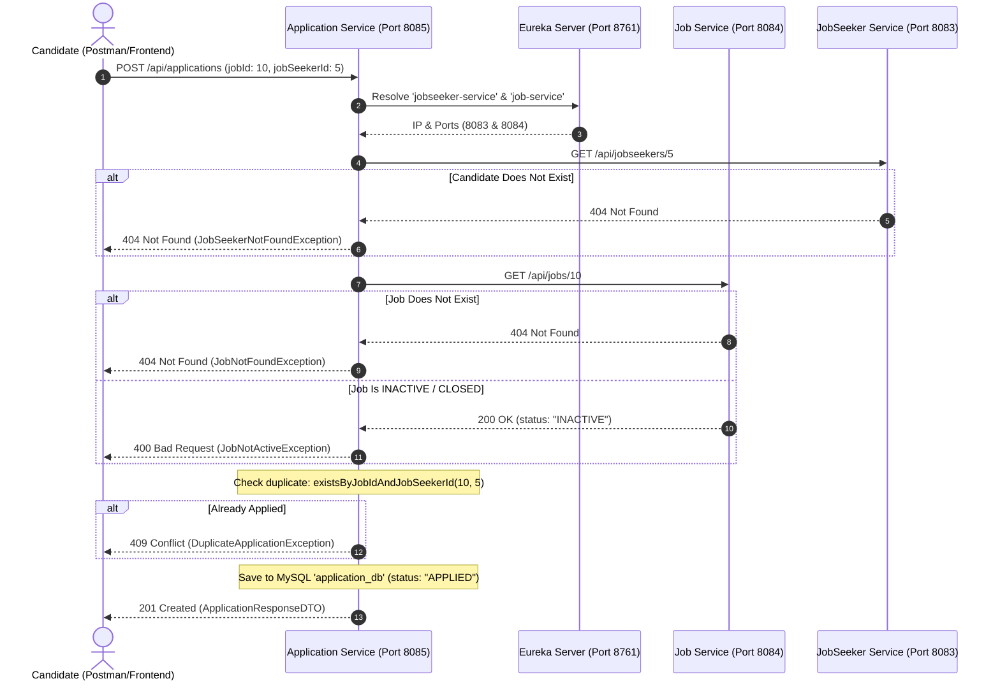
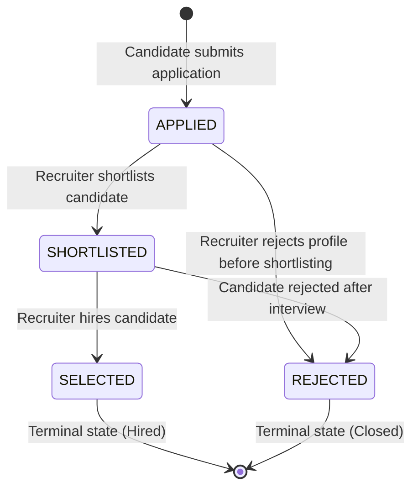

# Step 4: Application Microservice (`application-service`) — Architecture & Implementation Guide

## 1. Overview & Architectural Role

The **`application-service`** (running on **Port 8085**) is the core transactional orchestration engine of the **Job Search System (JSS)**. It bridges the gap between candidates searching for employment and employers seeking qualified talent.

In a distributed microservice architecture, `application-service` acts as a **Composite Transaction Service**:
1. It validates candidate identity against **`jobseeker-service` (Port 8083)** via OpenFeign.
2. It validates job opening validity and active status against **`job-service` (Port 8084)** via OpenFeign.
3. It prevents duplicate job applications (a candidate cannot apply to the same job multiple times).
4. It manages the streamlined 4-state recruitment lifecycle:
   $$\text{APPLIED} \longrightarrow \begin{cases} \text{SHORTLISTED} \longrightarrow \begin{cases} \text{SELECTED} \\ \text{REJECTED} \end{cases} \\ \text{REJECTED} \end{cases}$$
5. It performs **Data Enrichment (Application-Level Joins)** so that:
   * **Recruiters** viewing applicants get the candidate's profile (name, email, skills, experience).
   * **Job Seekers** viewing applied jobs get the job card (title, company name, location, salary range).

---

## 2. Service Specifications

| Specification | Configuration Detail |
| :--- | :--- |
| **Artifact ID** | `application-service` |
| **Port** | `8085` |
| **Database** | MySQL: `application_db` (`localhost:3306`) |
| **Spring Data JPA** | Hibernate `update`, Auto-DDL, MySQL 8 Dialect |
| **Service Discovery** | Eureka Client registered as **`APPLICATION-SERVICE`** |
| **Declarative Clients** | Spring Cloud OpenFeign enabled (`@EnableFeignClients`) |
| **API Documentation** | Springdoc OpenAPI 3.0 / Swagger UI (`/swagger-ui.html`) |
| **Lombok** | `@Data`, `@NoArgsConstructor`, `@AllArgsConstructor`, `@Builder` |

---

## 3. Dual OpenFeign Inter-Service Communication



---

## 4. Entity Model: `JobApplication.java` (8 Fields)

Mapped to table `job_applications` in `application_db`. Following database normalization, multiple individual date columns were consolidated into a single general `statusUpdatedDate`:

| Field Name | Java Type | Constraint / Default | Purpose |
| :--- | :--- | :--- | :--- |
| `applicationId` | `Long` | `@Id`, `@GeneratedValue(IDENTITY)` | Primary Key |
| `jobId` | `Long` | `@NotNull` | Target job opening ID (verified via OpenFeign) |
| `jobSeekerId` | `Long` | `@NotNull` | Applicant ID (verified via OpenFeign) |
| `applicationDate` | `LocalDateTime` | Auto-set in `@PrePersist` | Timestamp when application was submitted |
| `applicationStatus`| `String` | Default: `"APPLIED"` | Lifecycle status: `APPLIED`, `SHORTLISTED`, `SELECTED`, `REJECTED` |
| `statusUpdatedDate`| `LocalDateTime` | Nullable | Timestamp when recruiter updated status (`SHORTLISTED`, `REJECTED`, `SELECTED`) |
| `resumeUrl` | `String` | Optional (URL / Document link) | Candidate's submitted resume link |
| `employerRemarks` | `String` | Optional, Length = 1000 | Feedback or notes provided by the recruiter |

---

## 5. Recruitment Lifecycle State Machine



### Transition Validation Rules:
1. `APPLIED` $\rightarrow$ Allowed next states: `SHORTLISTED`, `REJECTED`.
2. `SHORTLISTED` $\rightarrow$ Allowed next states: `SELECTED`, `REJECTED`.
3. `SELECTED` $\rightarrow$ Final state. No further transitions allowed.
4. `REJECTED` $\rightarrow$ Final state. No further transitions allowed.
* Any illegal jump (e.g. `APPLIED` $\rightarrow$ `SELECTED` without shortlisting, or modifying a `REJECTED` candidate) immediately throws `InvalidStatusTransitionException` (`400 Bad Request`).

---

## 6. REST API Menu (7 Endpoints)

| Method | Endpoint URI | Request Body | Response Body | HTTP Status | Business Scenario |
| :--- | :--- | :--- | :--- | :--- | :--- |
| **`POST`** | `/api/applications` | `ApplicationRequestDTO` | `ApplicationResponseDTO` | `201 Created` | **Apply for Job:** Candidate submits an application. Validates candidate, validates active job, blocks duplicates. |
| **`GET`** | `/api/applications/{id}` | *None* | `ApplicationResponseDTO` | `200 OK` | **Lookup Application:** Fetch single application by ID, enriched with candidate and job summary. |
| **`GET`** | `/api/applications/jobseeker/{jobSeekerId}` | *None* | `List<ApplicationResponseDTO>` | `200 OK` | **Candidate Portal:** View all jobs a specific candidate has applied for and track progress. |
| **`GET`** | `/api/applications/job/{jobId}` | *None* | `List<ApplicationResponseDTO>` | `200 OK` | **Recruiter Portal:** View all candidates who applied for a specific job posting. |
| **`GET`** | `/api/applications/job/{jobId}/status/{status}` | *None* | `List<ApplicationResponseDTO>` | `200 OK` | **Recruiter Filter:** Filter job applicants by status (e.g. all `SHORTLISTED` or `SELECTED` applicants). |
| **`PATCH`**| `/api/applications/{id}/status` | `StatusUpdateRequestDTO` | `ApplicationResponseDTO` | `200 OK` | **Recruiter Action:** Partial update to modify status (`SHORTLISTED`, `SELECTED`, `REJECTED`) and remarks. |
| **`DELETE`**| `/api/applications/{id}` | *None* | `Map<String, String>` | `200 OK` | **Withdraw Application:** Candidate withdraws their application before review. |

---

## 7. DTO Design & Summary DTOs

### 1. `ApplicationRequestDTO` (Payload from Candidate)
```java
public class ApplicationRequestDTO {
    @NotNull(message = "Job ID is required")
    private Long jobId;

    @NotNull(message = "Job Seeker ID is required")
    private Long jobSeekerId;

    private String resumeUrl; // e.g. "https://resumes.storage/sathish_nadar_resume.pdf"
}
```

### 2. `StatusUpdateRequestDTO` (Payload from Recruiter on PATCH)
```java
public class StatusUpdateRequestDTO {
    @NotBlank(message = "Status is required")
    private String status; // "SHORTLISTED", "SELECTED", "REJECTED"

    private String employerRemarks; // e.g., "Selected after 2 technical rounds"
}
```

### 3. `JobSeekerSummaryDTO` (Fetched via Feign from `jobseeker-service`)
```java
public class JobSeekerSummaryDTO {
    private Long jobSeekerId;
    private String firstName;
    private String lastName;
    private String email;
    private String contactNumber;
    private String skills;
    private Double experience;
}
```

### 4. `JobSummaryDTO` (Fetched via Feign from `job-service`)
```java
public class JobSummaryDTO {
    private Long jobId;
    private String jobTitle;
    private String location;
    private Double salaryMin;
    private Double salaryMax;
    private String status;
    private Long employerId;
}
```

### 5. `ApplicationResponseDTO` (Enriched Composite View)
```java
public class ApplicationResponseDTO {
    private Long applicationId;
    private Long jobId;
    private Long jobSeekerId;
    private String applicationStatus;
    private String resumeUrl;
    private String employerRemarks;
    private LocalDateTime applicationDate;
    private LocalDateTime statusUpdatedDate;

    // Enriched dynamic profiles
    private JobSeekerSummaryDTO candidate;
    private JobSummaryDTO job;
}
```

---

## 8. Exception Handling Strategy

| Exception Class | HTTP Status | Trigger Condition |
| :--- | :--- | :--- |
| `ApplicationNotFoundException` | `404 Not Found` | Application ID does not exist in `application_db`. |
| `JobSeekerNotFoundException` | `404 Not Found` | Candidate ID not found in `jobseeker-service` via OpenFeign. |
| `JobNotFoundException` | `404 Not Found` | Job ID not found in `job-service` via OpenFeign. |
| `DuplicateApplicationException` | `409 Conflict` | Candidate has already applied for this `jobId`. |
| `JobNotActiveException` | `400 Bad Request` | Candidate attempts to apply for a job whose status is not `"ACTIVE"`. |
| `InvalidStatusTransitionException` | `400 Bad Request` | Illegal state change (e.g. `APPLIED` directly to `SELECTED`, or updating a closed `REJECTED` application). |
| `MethodArgumentNotValidException` | `400 Bad Request` | Missing or invalid bean validation fields. |

---

## 9. Doubt Solving & Conceptual Deep-Dives

### Doubt 1: Why replace `shortlistedDate` and `rejectedDate` with a single `statusUpdatedDate`?
* In any single application row, a candidate cannot be both shortlisted and rejected at the same time. Storing two columns means one column will always be `NULL`, creating unnecessary database clutter.
* By storing `applicationStatus` (e.g. `"SHORTLISTED"`, `"REJECTED"`, or `"SELECTED"`) alongside a single `statusUpdatedDate`, we know **what** the decision was and **when** it occurred with zero redundancy!

---

### Doubt 2: What is `@PatchMapping` and why use it instead of `@PutMapping`?
* In REST architecture:
  * **`PUT` (Complete Replacement):** Expects the entire resource representation. If you use PUT to change the status, the client must resend `jobId`, `jobSeekerId`, `resumeUrl`, and `applicationDate` or risk overwriting them with `null`.
  * **`PATCH` (Partial Update):** Designed specifically to update only **a subset of fields** on an existing resource.
* In Spring Boot, `@PatchMapping("/api/applications/{id}/status")` allows the recruiter to send only:
  ```json
  {
    "status": "SHORTLISTED",
    "employerRemarks": "Profile matched tech stack, scheduled interview for Friday"
  }
  ```
  The server updates only `applicationStatus`, `employerRemarks`, and `statusUpdatedDate`, leaving all original application fields untouched.

---

### Doubt 3: Does this 4-status transition path make the system complex?
* **No, it actually makes the system cleaner and more robust!**
* By reducing statuses to 4 clear business states (`APPLIED`, `SHORTLISTED`, `SELECTED`, `REJECTED`), we eliminate ambiguity.
* The transition validation is implemented with a lightweight 8-line method:
  ```java
  public boolean isValidTransition(String currentStatus, String newStatus) {
      if ("APPLIED".equals(currentStatus)) {
          return "SHORTLISTED".equals(newStatus) || "REJECTED".equals(newStatus);
      }
      if ("SHORTLISTED".equals(currentStatus)) {
          return "SELECTED".equals(newStatus) || "REJECTED".equals(newStatus);
      }
      return false; // SELECTED and REJECTED are terminal states
  }
  ```
* This prevents human error (e.g., an employer accidentally marking a brand new applicant as "Hired/Selected" without shortlisting them, or reviving a rejected candidate).

---

### Doubt 4: What is `@EnableDiscoveryClient` and why wasn't it visible in other microservices?
* **What it does:** `@EnableDiscoveryClient` is a Spring Cloud annotation that instructs the microservice to register itself with the Service Discovery Registry (such as Netflix Eureka, HashiCorp Consul, or Apache Zookeeper).
* **Why wasn't it in `employer-service` or `job-service`?**
  * In modern Spring Cloud (2020+), `@EnableDiscoveryClient` is **optional**.
  * As long as the `spring-cloud-starter-netflix-eureka-client` dependency exists in `pom.xml` and the `eureka.client.service-url.defaultZone` is present in `application.properties`, Spring Boot **auto-configures Eureka registration automatically**.
  * Adding `@EnableDiscoveryClient` is simply an explicit declarative marker. Leaving it out or removing it produces the exact same registration behavior.

---

### Doubt 5: Does the `name` attribute in `@FeignClient` have to match Eureka's registered service name?
* **YES, 100%!**
* When `application-service` declares:
  ```java
  @FeignClient(name = "job-service")
  ```
  Spring Cloud OpenFeign does not look up an IP address from code. Instead, it contacts Eureka Server (`http://localhost:8761`) and queries:
  *"Give me the network location of the service registered under `JOB-SERVICE`"*.
* If the name matches `spring.application.name=job-service`, Eureka returns `http://localhost:8084`.
* If there is a typo or mismatch (e.g. `@FeignClient(name = "jobs-api")`), Eureka has no instance registered with that name, and Spring Cloud LoadBalancer throws:
  `IllegalStateException: No instances available for jobs-api`.

---

### Doubt 6: Why keep `ErrorResponse` strictly at 5 fields across all microservices?
* **Uniform Architectural Standard:**
  Every microservice in the Job Search System (`employer-service`, `jobseeker-service`, `job-service`, and `application-service`) returns the exact same 5-field envelope:
  1. `timestamp`
  2. `status`
  3. `error`
  4. `message`
  5. `path`
* **How Bean Validation is Handled (Option A):**
  When multiple fields fail validation (e.g. both `jobId` and `jobSeekerId` are missing), the controller advice extracts each field's default message and joins them with semicolons into the `message` string:
  ```json
  {
    "timestamp": "2026-11-24T12:00:00",
    "status": 400,
    "error": "Validation Failed",
    "message": "Job ID is required; Job Seeker ID is required",
    "path": "/api/applications"
  }
  ```
  This keeps all error responses consistent, lightweight, and directly consumable by UI alert banners and toast notifications.

---

## 10. Gate 2: Implementation Readiness Checklist
* [x] **Entity Field Consolidation:** `shortlistedDate` + `rejectedDate` merged into `statusUpdatedDate` (8 fields total).
* [x] **Lifecycle State Machine:** 4 Statuses (`APPLIED` $\rightarrow$ `SHORTLISTED`/`REJECTED` $\rightarrow$ `SELECTED`/`REJECTED`).
* [x] **Controller Endpoint:** `@PatchMapping("/api/applications/{id}/status")` for partial status updates.
* [x] **Withdraw Mechanism:** `DELETE /api/applications/{id}` approved.
* [x] **Dual OpenFeign Clients:** `JobSeekerServiceClient` (8083) and `JobServiceClient` (8084).
* [x] **Exception Suite:** 7 Exceptions (404, 404, 404, 400, 409, 400, 400).

