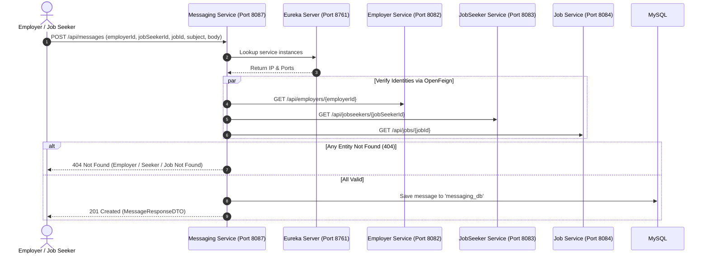

# Step 5: Messaging Microservice (`messaging-service`) — Architecture & Implementation Guide

## 1. Overview & Architectural Role

The **`messaging-service`** (running on **Port 8087**) provides direct, audited communication between Employers and Job Seekers.

In the recruitment workflow:
1. When an employer shortlists a candidate for an active job, they can send interview invitations, technical assessment links, or general feedback.
2. A job seeker can inquire about role requirements, update recruiters on notice periods, or accept interview schedules.
3. Every message is strictly contextualized to a **Job Opening (`jobId`)**, linking the employer and candidate together in a threaded conversation.

---

## 2. Service Specifications

| Specification | Configuration Detail |
| :--- | :--- |
| **Artifact ID** | `messaging-service` |
| **Port** | `8087` |
| **Database** | MySQL: `messaging_db` (`localhost:3306`) |
| **Spring Data JPA** | Hibernate `update`, Auto-DDL, MySQL 8 Dialect |
| **Service Discovery** | Eureka Client registered as **`MESSAGING-SERVICE`** (Port 8761) |
| **Declarative Clients** | Spring Cloud OpenFeign enabled (`@EnableFeignClients`) |
| **API Documentation** | Springdoc OpenAPI 3.0 / Swagger UI (`/swagger-ui.html`) |
| **Lombok** | `@Data`, `@NoArgsConstructor`, `@AllArgsConstructor`, `@Builder` |
| **Error Handling** | Standard 5-field `ErrorResponse` envelope |

---

## 3. Inter-Service Communication Flow



---

## 4. Key Architectural Decision: Dual Tables vs Unified Conversation Table

The specification document mentions two distinct entities:
* `EmployerMessage` (message from employer to candidate)
* `JobSeekerMessage` (message from candidate to employer)

Notice that both entities share the **exact same 7 fields**:
`messageId`, `employerId`, `jobSeekerId`, `jobId`, `subject`, `messageDescription`, `sentDate`.

### Option A: Unified Conversation Model (Recommended)
Store all messages in a single table `messages` with a `senderType` column (`"EMPLOYER"` vs `"JOB_SEEKER"`):
* **Advantage:** Enables fetching a full chronological conversation thread between an employer and candidate in a **single SQL query** (`ORDER BY sentDate ASC`), just like Slack, WhatsApp, or LinkedIn InMail.
* **Advantage:** Prevents duplicate code, duplicate repositories, and dual maintenance.

### Option B: Strict Two-Table Model
Create two separate JPA entities `EmployerMessage` (table: `employer_messages`) and `JobSeekerMessage` (table: `jobseeker_messages`):
* **Trade-off:** Viewing a unified conversation thread requires querying both tables and manually sorting/merging them in Java memory.

---

## 5. Entity Model: Unified `Message.java` (8 Fields)

Mapped to table `messages` in `messaging_db`:

| Field Name | Java Type | Constraint / Default | Purpose |
| :--- | :--- | :--- | :--- |
| `messageId` | `Long` | `@Id`, `@GeneratedValue(IDENTITY)` | Primary Key |
| `employerId` | `Long` | `@NotNull` | Hiring organization ID (verified via Feign) |
| `jobSeekerId` | `Long` | `@NotNull` | Candidate ID (verified via Feign) |
| `jobId` | `Long` | `@NotNull` | Target job opening ID (verified via Feign) |
| `senderType` | `String` | `@NotBlank`, `"EMPLOYER"` or `"JOB_SEEKER"` | Identifies who authored the message |
| `subject` | `String` | Optional (`nullable = true`), length = 200 | Optional subject line (e.g. "Interview Schedule"; omitted in casual chat) |
| `messageDescription` | `String` | `@NotBlank`, length = 3000 | Full message content |
| `sentDate` | `LocalDateTime` | Auto-set in `@PrePersist` | Timestamp when message was dispatched |

---

## 6. Streamlined 2-Endpoint REST API Menu

Following user-aligned system design, all unnecessary single-message CRUD and global inboxes were removed. Communication is strictly scoped to the job-specific conversation thread:

| Method | Endpoint URI | Request Body / Query Params | Response Body | HTTP Status | Business Scenario |
| :--- | :--- | :--- | :--- | :--- | :--- |
| **`POST`** | `/api/messages` | `MessageRequestDTO` | `MessageResponseDTO` | `201 Created` | **Send Message:** Recruiter or Candidate dispatches a message for a job. Validates all 3 IDs via OpenFeign. |
| **`GET`** | `/api/messages/conversation` | `?jobId=...&employerId=...&jobSeekerId=...` | `List<MessageResponseDTO>` | `200 OK` | **View Chat Thread:** Returns full chronological conversation for that job (`ORDER BY sentDate ASC`). Empty list if no messages yet. |

---

## 7. Exception Handling Strategy

Because single-message lookup and deletion were eliminated, `MessageNotFoundException` is not needed. Empty chats simply return `200 OK` with an empty array `[]`.

| Exception Class | HTTP Status | Trigger Condition |
| :--- | :--- | :--- |
| `EmployerNotFoundException` | `404 Not Found` | `employerId` not found in `employer-service` via OpenFeign. |
| `JobSeekerNotFoundException` | `404 Not Found` | `jobSeekerId` not found in `jobseeker-service` via OpenFeign. |
| `JobNotFoundException` | `404 Not Found` | `jobId` not found in `job-service` via OpenFeign. |
| `MethodArgumentNotValidException` | `400 Bad Request` | Missing or invalid fields (`@NotNull`, `@NotBlank`, or invalid `senderType` via `@Pattern`). |

---

## 8. Doubt Solving & Conceptual Deep-Dives

### Doubt 1: What is "Database Lock Contention" and why would someone use 2 tables?

#### The Concept:
In relational databases (like MySQL InnoDB), whenever a transaction writes or inserts a row into a table, the database temporarily places a **lock** on the relevant index pages or table blocks to guarantee ACID transactions and prevent data corruption.

#### The "Single Notebook" Analogy:
* **Scenario A (1 Table = 1 Register):** Imagine a classroom with **one single attendance notebook** on the teacher's desk.
  * If 5,000 students and 500 teachers all rush to write in the *same notebook* at 9:00 AM, they form a huge queue.
  * Everyone is waiting for the person in front to release the pen and notebook. That delay and competition for the same resource is called **Lock Contention**.
* **Scenario B (2 Tables = 2 Registers):**
  * You place one notebook for Teachers (`employer_messages`) and a separate notebook for Students (`jobseeker_messages`).
  * Teachers write freely in their book without ever being blocked by a student writing in theirs.

#### Why 2 Tables is Overkill for JSS:
Modern MySQL uses **Row-Level Locking**, which easily handles thousands of concurrent writes per second into a single table without noticeable contention. Splitting tables solely for lock contention is only necessary at massive scale (e.g. Twitter or WhatsApp handling 100,000+ writes/second). For a recruitment portal, the disadvantage of having to merge two tables during reading heavily outweighs any tiny write benefit.

---

### Doubt 2: Why prune the API menu down to just 2 endpoints?
1. **Eliminating `DELETE /api/messages/{id}`:** In professional recruitment, communication serves as an **audit trail** (interview call letters, salary negotiations, job acceptances). Deleting messages creates legal/compliance risks.
2. **Eliminating `GET /api/messages/{id}`:** No frontend renders a single chat message in isolation; messages are always consumed inside a chat thread.
3. **Focusing on the Job-Specific Conversation Thread:** By exposing `POST /api/messages` and `GET /api/messages/conversation`, we satisfy the exact problem statement without unnecessary bloat.

---

### Doubt 3: What happens if a user types `"employ"` instead of `"EMPLOYER"`, and do we need a custom exception?
* **If unhandled:** The database would silently save the invalid string `"employ"`. When the frontend loads the chat, it wouldn't know which side to align the message bubble (recruiter vs candidate), causing UI rendering bugs.
* **The Clean Solution (@Pattern):**
  Instead of writing manual `if-else` checks and creating a custom `InvalidSenderTypeException.java`, we apply Bean Validation directly on the DTO:
  ```java
  @NotBlank(message = "Sender type is required")
  @Pattern(regexp = "^(EMPLOYER|JOB_SEEKER)$", message = "Sender type must be either 'EMPLOYER' or 'JOB_SEEKER'")
  private String senderType;
  ```
* **Output in Swagger / Bruno when `"employ"` is sent:**
  Spring automatically triggers `MethodArgumentNotValidException` (`400 Bad Request`):
  ```json
  {
    "timestamp": "2026-11-24T16:45:00",
    "status": 400,
    "error": "Validation Failed",
    "message": "Sender type must be either 'EMPLOYER' or 'JOB_SEEKER'",
    "path": "/api/messages"
  }
  ```
  This eliminates the need for a separate custom exception class while providing an immediate, descriptive error response!

---

### Doubt 4: Does a conversation store everything in a single row (updating `messageDescription`), or create a new row for every message?

* **Every message creates a NEW row (`INSERT`), NOT an `UPDATE` on a single row!**
* For 1 Employer, 1 Job Seeker, and 1 Job, if they exchange 10 messages back and forth, the `messages` table in MySQL will contain **10 rows**—all sharing the same `(job_id, employer_id, job_seeker_id)` trio, each with its own `message_id`, `sender_type`, `message_description`, and `sent_date`.

| `message_id` | `job_id` | `employer_id` | `job_seeker_id` | `sender_type` | `message_description` | `sent_date` |
| :--- | :--- | :--- | :--- | :--- | :--- | :--- |
| `1` | `1` | `1` | `1` | `EMPLOYER` | "Are you free Thursday 11 AM?" | `10:00 AM` |
| `2` | `1` | `1` | `1` | `JOB_SEEKER` | "Yes, Thursday works!" | `10:05 AM` |
| `3` | `1` | `1` | `1` | `EMPLOYER` | "Great, sending invite link." | `10:07 AM` |

#### Why we NEVER overwrite/append into 1 single row:
1. **Sender Alignment (`senderType`):** A chat UI needs to know *who* sent *each* bubble (left side vs right side). A single row only holds one `senderType`.
2. **Individual Timestamps (`sentDate`):** Each chat message has its own timestamp; one row can't track 20 different timestamps cleanly.
3. **Why `length = 3000`:** `3000` characters is the limit for **one single message**, not an entire lifetime chat history. Merging everything into one column would quickly overflow the column limit.
4. **Concurrency Safety:** Appending new rows (`INSERT`) avoids race conditions if both parties send messages at the exact same second (whereas `UPDATE` on a single row risks overwriting data).
5. **How `GET /api/messages/conversation` puts them together:** It queries all rows matching `(jobId, employerId, jobSeekerId)` ordered by `sentDate ASC` and returns them as a `List<MessageResponseDTO>` array for the UI to render bubble by bubble.

---

### Doubt 5: What do `springdoc.swagger-ui.operations-sorter` and `tags-sorter` do in `application.properties`?
* Both are purely **UI visual sorting preferences** for `/swagger-ui.html` (zero effect on API behavior):
  * `operations-sorter=method`: Orders endpoints inside Swagger UI by HTTP verb (`DELETE`, `GET`, `POST`, `PUT`) instead of the order methods appear in the Java controller.
  * `tags-sorter=alpha`: Orders `@Tag` groups alphabetically on the Swagger page.
* They were also present in `application-service`, whereas `employer-service`, `jobseeker-service`, and `job-service` left Swagger UI in its default declaration order.

---

### Doubt 6: What is the difference between `messaging_db` vs `name = "messages"`, and how does `@Table(indexes = @Index(...))` work?
1. **Database vs Table (`messaging_db` vs `messages`):**
   * `messaging_db` (set in `spring.datasource.url`) is the **MySQL Schema / Database** container.
   * `name = "messages"` in `@Table` tells Hibernate the **table name** inside that database (`messaging_db.messages`), just like `job_db.jobs` and `employer_db.employers`.
2. **What `indexes = { @Index(...) }` does:**
   * Instructs Hibernate (`ddl-auto=update`) to run `CREATE INDEX idx_conversation_thread ON messages (job_id, employer_id, job_seeker_id, sent_date)` in MySQL.
   * `name`: The name of the index visible in MySQL Workbench.
   * `columnList`: Exact snake_case MySQL column names included in the B-Tree index, ordered to match our conversation query (`WHERE job_id = ? AND employer_id = ? AND job_seeker_id = ? ORDER BY sent_date ASC`).
3. **Why used here and not in other services:**
   * Other services mainly look up records by Primary Key (`id`, which MySQL indexes automatically) or use `LIKE '%keyword%'` wildcard searches (which cannot use standard B-Tree indexes).
   * `messages` stores many rows per conversation and every chat lookup filters on 3 foreign keys (`job_id, employer_id, job_seeker_id`) and sorts by a 4th (`sent_date`). Without this index, MySQL would have to perform a full table scan on every chat load; with it, MySQL jumps straight to the thread in sub-milliseconds.

---

### Doubt 7: Why does `subject` exist in the schema, and how does it behave in casual chat (`"hi gm"`)?
* **Origin in `Job Search System.docx`:** The case study document explicitly modeled messaging like **LinkedIn InMail / formal email** (`subject` + `messageDescription`), where an employer sends a formal invite (Subject: *"Interview Round 1"*) rather than quick WhatsApp-style chat lines (`"hi sathish, good morning"` $\rightarrow$ `"hello, gm"`).
* **Problem if `subject` is mandatory (`nullable = false` + `@NotBlank`):** Every casual quick chat reply without a subject would fail validation with `400 Bad Request: Subject is required`, creating friction in a chat UI.
* **Aligned Decision (Option 2 Applied):** `subject` is kept as **optional** (`nullable = true` in `Message.java`, `@NotBlank` removed from `MessageRequestDTO`, and null-safe trimming in `MessageServiceImpl`). Formal messages can include a subject while quick replies leave it empty (`null`).

---

### Doubt 8: What exact SQL query does Hibernate generate in MySQL for `@Index(name = "idx_conversation_thread", ...)`?

1. **Table & Index Creation SQL (DDL):**
   ```sql
   CREATE TABLE messages (
       message_id BIGINT NOT NULL AUTO_INCREMENT,
       employer_id BIGINT NOT NULL,
       job_id BIGINT NOT NULL,
       job_seeker_id BIGINT NOT NULL,
       message_description VARCHAR(3000) NOT NULL,
       sender_type VARCHAR(20) NOT NULL,
       sent_date DATETIME(6) NOT NULL,
       subject VARCHAR(200),
       PRIMARY KEY (message_id)
   ) ENGINE=InnoDB;

   CREATE INDEX idx_conversation_thread
   ON messages (job_id, employer_id, job_seeker_id, sent_date);
   ```
   *(Note: MySQL uses `ON table_name (...)`, or `ALTER TABLE messages ADD INDEX idx_conversation_thread (...)` when updating an existing table.)*

2. **How MySQL uses it on `GET /api/messages/conversation`:**
   ```sql
   SELECT *
   FROM messages
   WHERE job_id = 1
     AND employer_id = 1
     AND job_seeker_id = 1
   ORDER BY sent_date ASC;
   ```
   Because the B-Tree index stores `(job_id, employer_id, job_seeker_id, sent_date)` in that exact left-to-right order, MySQL jumps directly to the matching conversation rows—already pre-sorted by `sent_date`—avoiding both a Full Table Scan and an expensive `filesort`.

---

### Doubt 9: Where do `NOT NULL` and `AUTO_INCREMENT` on `message_id` come from in JPA?
* **`@Id` automatically implies `NOT NULL` + `PRIMARY KEY`:** In relational databases and JPA, a Primary Key can never be `NULL`, so Hibernate automatically appends `NOT NULL` and `PRIMARY KEY (message_id)` without needing `nullable = false`.
* **`@GeneratedValue(strategy = GenerationType.IDENTITY)` produces `AUTO_INCREMENT`:** It tells Hibernate to delegate primary key generation to MySQL's native auto-increment counter (`1, 2, 3...`).

---

### Doubt 10: What does `ENGINE=InnoDB` mean, what are other MySQL engines, and why do we use InnoDB?
* **What is a Storage Engine?** Unlike monolithic databases, MySQL separates SQL parsing from how bytes are physically written to disk. Think of SQL as the steering wheel and the **Storage Engine** as the engine under the hood.
* **Why `ENGINE=InnoDB` (MySQL's Default Engine):**
  1. **ACID Transactions (`@Transactional`):** Supports `COMMIT` and `ROLLBACK`.
  2. **Row-Level Locking:** Allows concurrent inserts/updates on different rows without freezing the whole table.
  3. **Crash Recovery & Foreign Keys:** Protects data integrity via redo/undo logs.
* **Other MySQL Storage Engines:**
  * **`MyISAM` (Legacy):** Fast simple reads, **no transactions** (`@Transactional` rollback fails!) and uses coarse **Table-Level Locking**.
  * **`MEMORY` (HEAP):** Keeps data only in RAM (wiped on server restart).
  * **`CSV` / `ARCHIVE`:** Plain `.csv` storage or compressed write-once audit logs.

---

### Doubt 11: Is a B-Tree a Binary Tree, and how does `idx_conversation_thread` actually store data?
* **Not a Binary Tree!** **B-Tree = Balanced Tree** (specifically **B+Tree** in MySQL InnoDB). While a Binary Tree holds 2 children per node (growing very tall), a B+Tree holds hundreds of sorted keys per node—staying **3–4 levels shallow even for 100 million rows**.
* **Clustered vs. Secondary Index:**
  * Actual message rows live in the **Clustered Index** (ordered by `message_id`).
  * `idx_conversation_thread` creates a separate, lightweight **Secondary B+Tree** containing ONLY `(job_id, employer_id, job_seeker_id, sent_date) -> message_id`.
* When reading a thread, MySQL searches the compact B+Tree to get the matching `message_id` pointers already ordered chronologically, then fetches the full messages!

---

### Doubt 12: What does `SHOW INDEX FROM messaging_db.messages;` output look like?
In MySQL Workbench (once Hibernate creates the table), running `SHOW INDEX FROM messaging_db.messages;` returns **5 rows**—1 for the Primary Key (`PRIMARY`) and 4 rows representing each column inside our composite index (`idx_conversation_thread`):

| Table | Non_unique | Key_name | Seq_in_index | Column_name | Collation | Index_type |
| :--- | :--- | :--- | :--- | :--- | :--- | :--- |
| `messages` | `0` | `PRIMARY` | `1` | `message_id` | `A` | `BTREE` |
| `messages` | `1` | `idx_conversation_thread` | `1` | `job_id` | `A` | `BTREE` |
| `messages` | `1` | `idx_conversation_thread` | `2` | `employer_id` | `A` | `BTREE` |
| `messages` | `1` | `idx_conversation_thread` | `3` | `job_seeker_id` | `A` | `BTREE` |
| `messages` | `1` | `idx_conversation_thread` | `4` | `sent_date` | `A` | `BTREE` |

* **`Non_unique`:** `0` means unique (PK); `1` means duplicates allowed (multiple messages share one thread).
* **`Seq_in_index` (`1..4`):** Left-to-right column order inside the composite B+Tree.
* **`Collation` (`A`):** Sorted Ascending.
* **`Index_type` (`BTREE`):** Stored as a balanced B+Tree.

---

### Doubt 13: Why does `GlobalExceptionHandler` call `buildResponse(...)` instead of repeating `ErrorResponse.builder()...build()` in every handler?
* **`ErrorResponse.builder()...build()` IS still used!** Scroll down to lines 78–88 at the bottom of `GlobalExceptionHandler.java`:
  ```java
  private ResponseEntity<ErrorResponse> buildResponse(
          HttpStatus status, String errorTitle, String message, HttpServletRequest request) {
      ErrorResponse error = ErrorResponse.builder()
              .timestamp(LocalDateTime.now())
              .status(status.value())
              .error(errorTitle)
              .message(message)
              .path(request.getRequestURI())
              .build();
      return ResponseEntity.status(status).body(error);
  }
  ```
* **DRY Refactoring (Don't Repeat Yourself):** Instead of copying and pasting those exact 8 `.builder()` lines 7 separate times across every `@ExceptionHandler`, extracting them into a single `private` helper method keeps every handler clean (1 line) while returning the **exact same 5-field `ErrorResponse` JSON**.

---

### Doubt 14: Why does `messaging-service` have `MissingServletRequestParameterException`, what triggers it, and what happens without it?
1. **What triggers it (`MessageController.java`):**
   * Look at `getConversation`:
     ```java
     @GetMapping("/conversation")
     public ResponseEntity<List<MessageResponseDTO>> getConversation(
             @RequestParam Long jobId,
             @RequestParam Long employerId,
             @RequestParam Long jobSeekerId)
     ```
   * By default, `@RequestParam` has `required = true`. If a caller hits `/api/messages/conversation?jobId=1&employerId=1` without `jobSeekerId`, **Spring MVC automatically throws `MissingServletRequestParameterException`** before entering the method—no manual `throw` statement is needed in Java.
2. **Why earlier services didn't have it:**
   * In `employer-service`, `jobseeker-service`, and `job-service`, every `@RequestParam` was explicitly marked `required = false` (optional search filters).
   * `application-service` had zero `@RequestParam` endpoints (only `@PathVariable` and `@RequestBody`).
   * `messaging-service` is the only service with mandatory `@RequestParam` parameters.
3. **What happens WITHOUT `handleMissingParam`:**
   * Because `GlobalExceptionHandler` defines a catch-all `@ExceptionHandler(Exception.class)`, Spring routes the unhandled `MissingServletRequestParameterException` into `handleGenericException` and mistakenly returns **HTTP `500 Internal Server Error`** instead of **`400 Bad Request`**!
   * Adding `handleMissingParam` ensures the client accurately gets `400 Bad Request` with `"Required query parameter 'jobSeekerId' is missing"`.

---

### Doubt 15: What happens before a controller method runs (`@Valid` vs `@RequestParam`), and is `@Parameter` optional?
1. **Execution Order Before Entering Controller Code:**
   * Both `MissingServletRequestParameterException` and `MethodArgumentNotValidException` happen **inside Spring MVC before your controller method body executes**.
   * However, they are triggered by different mechanisms:
     * `MissingServletRequestParameterException` is triggered by **Spring MVC parameter binding (`@RequestParam`)**—even if `@Valid` is NOT present.
     * `MethodArgumentNotValidException` is triggered specifically by **`@Valid`** after JSON deserialization (`@RequestBody`) when DTO field constraints (`@NotNull`, `@NotBlank`, `@Pattern`, `@Size`) fail.
2. **Role of `@Parameter` (`io.swagger.v3.oas.annotations.Parameter`):**
   * `@Parameter` is **strictly for Swagger UI documentation** (`description` text, `example = "1"` autofill when clicking *Try it out*, and displaying `* required`).
   * **Why `required = true` wasn't written on `@RequestParam`:** Spring's `@RequestParam` already has `required = true` as its default! You only write `required = false` when making it optional.
   * **Can `@Parameter` be removed?** Yes! The REST endpoint runs identically without it (as seen in `EmployerController` and `JobController`).

---

### Doubt 16: Enriching Chat Responses with Org Name, Recruiter Contact Person, Candidate Full Name, and Full Job Context `(i)`
* **Real-World UX Problem:**
  1. Knowing only `"Capgemini"` isn't personal—candidates want to see **who** is messaging them (`contactPerson` alongside `organizationName`), and recruiters need the candidate's full name (`firstName` + `lastName`).
  2. When a candidate applies to 100+ jobs, seeing a chat message without remembering the exact role details (skills, salary, location, description) makes it difficult to reply effectively.
* **Aligned Solution Applied to `MessageResponseDTO` & Feign Summary DTOs:**
  * `EmployerSummaryDTO`: Fetches `employerId`, `organizationName`, and `contactPerson` $\rightarrow$ mapped to `organizationName` and `employerName`.
  * `JobSeekerSummaryDTO`: Fetches `jobSeekerId`, `firstName`, and `lastName` $\rightarrow$ mapped to full `jobSeekerName`.
  * `JobSummaryDTO`: Fetches the complete job opening profile (all 16 non-nested fields from `JobResponseDTO`: `jobTitle`, `designation`, `description`, `requiredSkills`, `experienceRequired`, `qualification`, `salaryMin`, `salaryMax`, `location`, `noticePeriod`, `contactEmail`, `employmentType`, `status`, `createdDate`) and embeds it as `private JobSummaryDTO job;` in `MessageResponseDTO` so the frontend `(i)` button can display the complete job card directly inside the chat window!
  * `MessageServiceImpl.getConversation(...)` still makes only **1 set of Feign calls per thread** (not per message) before mapping all chat bubbles.

---

## 9. Gate 2: Implementation Readiness Checklist
* [x] **Data Model:** Unified `Message.java` table with `senderType` column.
* [x] **Streamlined APIs:** Strictly 2 endpoints (`POST /api/messages`, `GET /api/messages/conversation`).
* [x] **Lean Exceptions:** 3 OpenFeign 404s + 1 Bean Validation 400 handler.
* [x] **Triple OpenFeign Clients:** `EmployerServiceClient` (8082), `JobSeekerServiceClient` (8083), `JobServiceClient` (8084).
* [x] **Error Response Format:** Standard 5-field envelope (`timestamp`, `status`, `error`, `message`, `path`).

